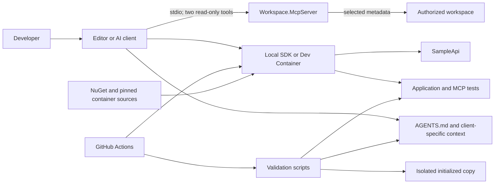

# Architecture

## Overview

The workspace is a small reference system, not a production application framework.
`SampleApi` demonstrates the production boundary, its tests exercise observable HTTP
behavior, and `Workspace.McpServer` is development tooling that is never referenced
by production code. Repository configuration surrounds those projects with a
reproducible environment, AI context, security policy, and deterministic checks.

Arrows show allowed interactions, not automatic trust. Source, issue, dependency,
tool, and external content remain untrusted inputs.

## Components and responsibilities

| Component | Responsibility | Boundary |
| --- | --- | --- |
| `src/SampleApi` | HTTP routing, transport validation, and response mapping for the example. | Does not reference MCP, an AI client, or an external provider. |
| `tests/SampleApi.Tests` | Verifies observable endpoint behavior through the hosted application. | Test helpers do not provide production behavior. |
| `tools/Workspace.McpServer` | Returns a sanitized project catalog and the architecture section of `AGENTS.md`. | Local stdio only; no writes, commands, network, credentials, or generic file reads. |
| `tests/Workspace.McpServer.Tests` | Verifies configuration, path containment, sanitization, annotations, and protocol behavior. | Uses temporary local workspaces and does not authorize broader capabilities. |
| AI context files | Describe shared policy, scoped guidance, roles, prompts, and procedures. | Guidance does not itself enforce sandboxing or approvals. |
| Dev Container and VS Code | Provide a consistent SDK and equivalent restore/build/test entry points. | The mounted workspace is writable; host and container runtime remain trusted externally. |
| Scripts and CI | Validate structure, security invariants, evaluations, .NET behavior, and a renamed copy. | CI has read-only repository permission and no baseline secrets. |
| Evaluations | Define paired scenarios and an evidence schema. | Structural validation is not a real model run. |

## Assisted-development flows

### Implement and verify

1. A human supplies the task and reviews repository guidance.
2. The client combines shared context with applicable client/path-specific files.
3. The agent inspects existing code and makes a scoped workspace change under the
   client's effective permissions.
4. `validate-change` selects the relevant repository-owned commands.
5. The human reviews the diff and evidence before any commit or remote operation.
6. CI repeats the deterministic checks on a pull request.

### Read-only architecture review

1. The user selects `Architecture Reviewer` and the review prompt where supported.
2. The reviewer can read/search and call only `workspace/*` tools.
3. MCP inventories sanitized project relationships and returns the applicable
   responsibility rules.
4. The reviewer separates facts, hypotheses, recommendations, and unavailable checks.

### Template derivation

1. GitHub creates a new repository from the default branch after template mode is enabled.
2. The user runs `initialize-template.sh` with validated .NET identifiers.
3. Known solution, project, namespace, configuration, and documentation references change.
4. The state file makes identical reruns safe and conflicting reruns fail closed.
5. `validate-template.sh` proves the derived copy formats, builds, and tests without
   changing the source workspace.

## External integrations and dependencies

- The .NET SDK is selected by `global.json`; NuGet dependencies are centrally
  versioned and locked per project.
- The Dev Container image and GitHub Actions are pinned by immutable digest or SHA.
- GitHub hosts source, pull requests, Actions, Dependabot, and template settings;
  branch and organization controls are not stored in this repository.
- Copilot and Codex are optional clients. Their authentication, model service,
  policy, and some network paths remain external.
- The Model Context Protocol C# SDK provides the local stdio transport. The checked-in
  MCP server itself performs no network access.

The reasoning behind these boundaries is recorded in [ADRs](decisions/README.md),
and abuse cases are covered by the [threat model](security/threat-model.md).
